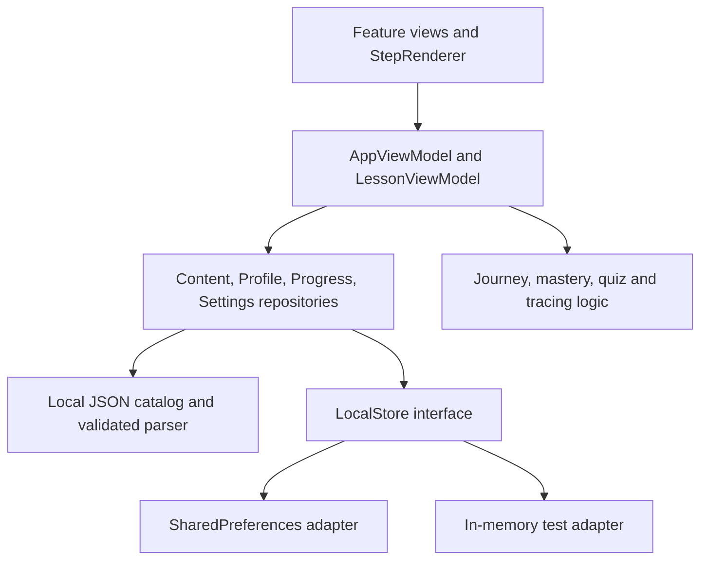

# LittleSteps

An original, local-first Flutter educational starter for two demo explorers: **Mia, age 3**, and **Arjun, Grade 2**. Each profile receives a separate curriculum. Mia gets larger cards, short prompts and two-choice quizzes; Arjun gets reading, reasoning and more detailed activities. No proprietary app designs, lessons, characters, recordings or artwork are included.

The MVP implements a loading splash, profile picker, child home, daily journey, subject and topic browsing, lesson runner, quizzes, matching, drag/drop, tracing, coloring, results, progress, parent gate, dashboard and settings. These are composed views sharing one content system and reusable engines.

## Run and verify

Requires a Flutter SDK with Dart 3.8 or newer. Verified using the existing **Flutter 3.47.5 / Dart 3.13.4** installation on this machine.

```powershell
# Only needed on this machine if Flutter is not already on PATH:
$env:Path = "C:\Users\lazyg\develop\flutter\bin;" + $env:Path
flutter pub get
flutter run -d chrome

# With a connected Android phone or emulator:
flutter devices
flutter run -d DEVICE_ID

dart format --output=none --set-exit-if-changed lib test
flutter analyze
flutter test --concurrency=1
flutter build web --no-web-resources-cdn --no-wasm-dry-run
```

Android requires the usual Android SDK, accepted licenses and a device/emulator. Android release packaging has not been verified in this environment. Web release compilation is checked. Serve `build/web` through HTTP; do not open its HTML as a `file://` document:

```powershell
python -m http.server 8080 --directory build/web
# Open http://localhost:8080 in a browser.
```

Content and preferences work locally. The Android app has no runtime network requirement. Web resources are built with a local CanvasKit path; web still requires the static files to be served. This starter does not install a service worker or promise offline browser reloads without that server. Browser storage can be cleared by the browser or the user. Essential Hindi glyphs use a bundled OFL-licensed Noto Devanagari font; emoji rendering still varies by platform.

## Architecture and state



Flutter's `ChangeNotifier` and `ListenableBuilder` provide MVVM-style state updates without a third-party state-management package. Instances are explicitly injected from the bootstrap; widgets do not reach into mutable global singletons. `AppViewModel` owns selected-profile/session state, persisted progress and settings commands. `LessonViewModel` owns step sequencing, quiz feedback and game selection state. Domain functions hold assessment and journey rules. Views render state and forward commands; drawing history and pointer rendering stay local to creative widgets.

Repositories provide the source of truth. The only runtime package beyond Flutter is `shared_preferences`, because Flutter has no built-in cross-platform durable preference API. `LocalStore` is abstract because save failures and reload behavior need testing independently of platform plugins. The domain has no Flutter imports. No network, authentication, database, service locator, generated model framework or routing package is needed for this starter.

```text
lib/
  app/                 App, named routes, dependency wiring and design tokens
  core/widgets/        Shared page/card widgets and safe image fallback
  domain/models/       Typed profiles, lessons, games, mastery and settings
  domain/use_cases/    Daily journey, quiz evaluation and tracing algorithm
  data/dto/            Validated JSON parsing with per-lesson isolation
  data/repositories/   Content, profiles, progress and settings
  data/services/       Local persistence and honest media placeholders
  features/
    profiles/          Profile picker
    home/              Home, subjects, topics, journey and progress views
    lessons/           Runner, StepRenderer, quiz UI and lesson ViewModel
    games/             Configured matching/drag-drop and creative prototypes
    parent/            Gate, dashboard and settings
assets/content/        Original catalog.json
assets/fonts/          Offline Hindi font and its distribution license
test/domain/           Domain, parsing, repository and ViewModel checks
test/widgets/          Navigation, activity progression and gate checks
tools/                 Reproducible original content/icon generators
docs/                  Git workflow and validation record
android/, web/         Standard Flutter platform launchers, original app marks
```

Related small views share files where that makes navigation easier. There are no empty folders, duplicate game engines or ceremonial use-case layers for ordinary repository calls. `Tokens` centralizes spacing, corner radius, type, button sizes and animation duration. Settings and OS reduced-motion preferences are exposed through `MediaQuery`; custom activities avoid automatic animated distractions.

## Available original demo content

| Explorer | Topics |
| --- | --- |
| Mia: 10 lessons | Colors (red/blue/yellow), circle/square/triangle, counting 1–5, dog/cat/elephant, handwashing, happy/sad/angry, A/B/C, Hindi letter demo, nearby park, paper-boat story |
| Arjun: 16 lessons | Nouns, verbs, reading comprehension, place value, addition, subtraction, number patterns, plant parts, water, weather, road safety, emotions, Hindi word demo, community helpers, cooperation story, creative art |

All eight subjects are seeded: English, Maths, Hindi, Science & Nature, World Around Us, Life Skills, Stories, Art & Creativity. Hindi entries deliberately demonstrate Unicode and a few words; they are not a complete Hindi curriculum. Preschool and Grade-2 content never cross profiles unless a lesson explicitly lists both age bands.

## Add a subject and topic

Edit `assets/content/catalog.json`. Add to `subjects`:

```json
{"id":"music","title":"Music & Rhythm","symbol":"♪"}
```

Add a topic under `topics`:

```json
{"id":"beats","subjectId":"music","title":"Friendly beats"}
```

Add `music` to the default `ParentSettings.enabledSubjects` set if it should start enabled. For an existing installation, enable the new subject in Parent settings. Subject/topic navigation comes from JSON; no screen change is needed.

## Add a lesson

Append an entry to `lessons` using a unique ID and an existing topic/subject relationship:

```json
{
  "id":"beats_01",
  "subjectId":"music",
  "topicId":"beats",
  "ageBands":["preschool3"],
  "title":"Two friendly claps",
  "objectives":["Notice two beats"],
  "difficulty":1,
  "estimatedMinutes":2,
  "steps":[
    {"type":"story","text":"Tap your knees twice: tap, tap."},
    {"type":"offlineActivity","text":"Clap twice with a grown-up."}
  ]
}
```

The single `LessonRunner` chooses the corresponding activity through `StepRenderer`, saves after meaningful steps, and resumes at the next saved step. Completed lessons can be replayed. No Flutter UI changes are needed to add content using an existing activity type. Keep preschool instructions brief and give two or three choices.

The parser rejects duplicate lesson IDs, invalid age bands, missing topic relationships, empty steps, invalid quiz answer references and ambiguous matching pairs. Individual malformed lessons are skipped and logged for development. A broken catalog has safe empty-content UI. Unknown activity types render a safe message and can be skipped. Missing lessons are rejected at routing time, including lessons outside the selected age band or disabled subjects. Missing media does not crash the app.

## Add a quiz

Quiz questions are embedded in steps to keep the demo authoring format small. Both `mcq` and `imageChoice` use the same evaluation engine. Image-style choices currently use neutral text/symbol placeholders.

```json
{
  "type":"mcq",
  "question":{
    "prompt":"What comes after 2?",
    "answers":[{"id":"three","text":"3"},{"id":"five","text":"5"}],
    "correctId":"three",
    "explanation":"Count one, two, three. Three comes after two."
  }
}
```

Answers remain available after an error. Feedback invites another try; after two incorrect attempts the explanation appears. First-attempt success scores 2, success after a retry scores 1, and an unsolved question scores 0. Scores are internal engine values, not a competitive leaderboard. Mastery records first-attempt versus retry success. The audio button explains that recordings are unavailable; it does not silently pretend to speak.

## Add matching, drag/drop or creative activities

```json
{"type":"matching","text":"Find each partner.","pairs":{"Dog":"Puppy","Cat":"Kitten"}}
```

Pairs must have distinct right-hand labels. The engine knows no subject-specific rules. Tap the left item, then its matching right item.

```json
{"type":"dragDrop","text":"Sort the words.","categories":{"Garden":"Noun","Run":"Verb"}}
```

Drag an item into a category or use the accessible tap-item/tap-category alternative. Incorrect placements remain available for another try.

```json
{"type":"tracing","text":"Follow the round path.","path":"circle"}
{"type":"coloring","text":"Give the balloon a color."}
```

Tracing supports `line`, `circle` and `letter`. `TracingEvaluator` samples a normalized target path and computes the proportion covered by input within configurable tolerance (default 0.09 of the canvas scale). Completion unlocks at 70% coverage; it does not require pixel-perfect writing. It measures approximate coverage, not handwriting quality or stroke order. Coloring offers palette selection, tap-to-fill, undo and reset for a simple original outline.

`video` and `animation` currently show an original symbolic placeholder and local instructional text. `story` and `offlineActivity` show original text with a large Next/Done button. Other enumerated future activity types fall back safely rather than claiming to implement a game they do not yet support.

## Mastery, progress and rewards

`ConceptMastery` records attempt count, correct first attempt, correct after retry/hint, incorrect attempts and last-practiced date. The replacement-friendly deterministic rule is:

1. No recorded activity: `notStarted`.
2. Previously practiced, but not in seven days: `needsReview`.
3. At least three first-attempt successes: `mastered`.
4. At least two successes overall: `practicing`.
5. One success: `learning`.
6. Introduced without success: `introduced`.

In this starter a lesson ID is also its concept ID, and "after hint" includes any correct answer after a retry. The introduction creates an introduced record; evaluated steps update answer evidence. This heuristic is **not scientifically validated** and does not claim to diagnose a child's ability.

Progress saves the highest completed step per lesson, mastery and approximate duration separately for each child. Storage writes must succeed before the runner advances. A failed write shows a retry message. Reopening a completed lesson starts a replay; completion counts and learning stars remain unique per lesson. Results show a simple learning star, sticker symbol and achievement card text. No random rewards, purchases, punishments, leaderboards or screen-time incentives exist.

## Daily journey

`BuildDailyJourneyUseCase` filters by profile and enabled subjects, then selects at most one unique lesson from each category in order: a new concept, most recently practiced concept, a concept needing review, a game, and a creative/story lesson. It never exceeds five lessons and never fills an empty category with inappropriate content. A new profile naturally has fewer than five suggestions until it has recent/review evidence. Sessions are bounded, with a gentle break screen checked when entering/advancing activities; there is no child-facing countdown or infinite feed.

## Parent mode and settings

Use **Parents** from child home. Hold the gate for two seconds, then answer the adult arithmetic question. Parent routes are guarded even when requested directly. Leaving the area, switching profiles or backgrounding the app locks it. This is a convenience gate for an MVP, not authentication or a security boundary against a determined user.

The dashboard shows the selected child, approximate learning minutes, unique activity count, completed lessons, practiced subjects and concepts needing review. Settings persist daily time goal, maximum session length, enabled subjects, language preference, sound preference and reduced motion. The interface is primarily English; the Hindi preference and sound switch are stored affordances for the next content/audio iteration. Settings are household-wide; progress is per child.

## Privacy and accessibility

Only built-in nicknames and age bands are used. No real names, birth dates, emails, phone numbers, location, contacts, camera, microphone, ads, analytics, tracking SDKs, authentication or purchases are collected. Child screens contain no external links. There is no application backend. Local preferences are not encrypted and can be removed with app/browser storage; they should contain no sensitive data. Export, cloud sync and parent identity are out of scope.

Important controls use large targets, readable text and semantics. Feedback uses words and symbols as well as color. Drag/drop has a tap alternative. Tracing remains a touch/mouse prototype and needs an alternative activity for children who cannot draw. Hindi uses the bundled Noto font under SIL OFL 1.1, included at `assets/fonts/OFL-NotoSansDevanagari.txt`; Flutter's standard Material icons are provided by the SDK. All lesson prose, app marks and instructional configurations are original.

## Current limits and next development

- This is a starter curriculum, not an accredited or complete educational program. Have educators review content and age appropriateness before real use.
- Media/audio are honest placeholders. Translation, recorded instructions and richer original illustrations are the next content task.
- Coloring is one fill region; tracing measures coverage only. Drawings and in-progress game selections are not saved; successful steps are saved.
- Minutes are approximate wall-clock step durations, capped at five minutes per step; offline activities and interruptions can affect totals. Daily goals are guidance, not daily time accounting. Session limits are checked at step boundaries, not a background timer, and a new profile session resets the session clock.
- There is no content migration/version negotiation, export, encrypted storage, cloud sync, custom profile editor or full localization.
- Web compile and automated tests are verified. Android hardware behavior, screen-reader testing, Devanagari shaping on target devices and tablet layouts still need device QA.

Recommended next task: test Mia and Arjun's complete lesson flows on an Android phone, review them with an educator, and replace one preschool placeholder with an original recorded Hindi/English instruction. Keep content additions in JSON and extend an engine only when a concrete lesson needs it.

## Git, commits and merges

The repository is initialized with `main`, `develop` and three phase branches, with coherent commits and explicit merge history. The local MVP release is tagged `v0.1.0`. Nothing is pushed to a hosting service.

Read **[docs/GIT_WORKFLOW.md](docs/GIT_WORKFLOW.md)** for branch meanings, everyday commands, focused commits, merges, conflict resolution, release tags, undoing mistakes and optional GitHub setup. See **[docs/VALIDATION.md](docs/VALIDATION.md)** for checks and remaining verification limits.

To edit the catalog directly, do not run the seed generator afterward: `python tools/seed_content.py` intentionally regenerates the original 26-lesson demo and overwrites the JSON. `python tools/make_icons.py` regenerates only the original stepping-stone launcher icons.
